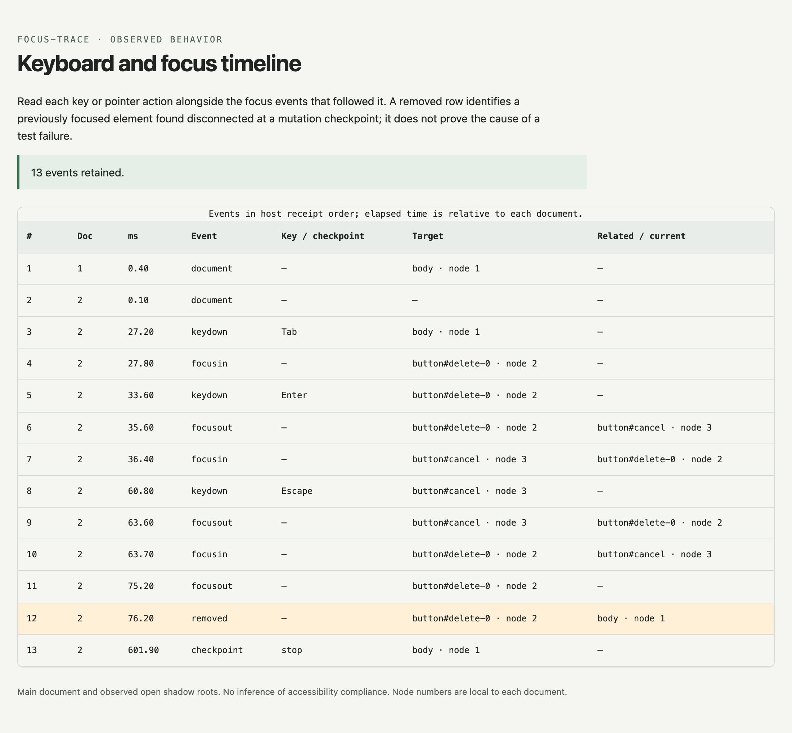

# focus-trace

See where keyboard focus went when a Playwright test fails.

focus-trace records focus changes, navigation keys, pointer presses and removed
focused elements during a test. When the test fails, it attaches a JSON timeline
and a self-contained HTML report. It only observes: it never calls `focus()`,
prevents an event, or changes tab order.



Version 0.1, not yet on npm. Tested with Chrome on macOS and with Playwright's
Chromium on Linux in CI; Firefox and WebKit are not tested yet. See [validation status](docs/validation.md).

## Playwright Test

The package is local and unpublished. Build and pack it, then install the tarball
in a project using Playwright 1.64.1 or a compatible 1.x version:

```sh
npm ci
npm run build
npm pack
```

Use the exported fixture instead of the base Playwright test:

```ts
import { test, expect } from '@yasirdora/focus-trace/test';

test('closing the dialog restores focus', async ({ page }) => {
  await page.goto('/settings');
  const trigger = page.getByRole('button', { name: 'Edit profile' });
  await trigger.click();
  await page.keyboard.press('Escape');
  await expect(trigger).toBeFocused();
});
```

Recording starts before the test body. When the actual result differs from the
expected result, fixture teardown attaches `focus-trace.json` and
`focus-trace.html`. An expected failure does not automatically attach a report;
call `focusTrace.attach(testInfo)` when you want an attachment regardless of status.
The HTML file uses no scripts, external assets, or network requests.

Keep Playwright's own trace enabled when you need DOM snapshots, screenshots,
network requests, or action call logs. This report supplements that trace.

### Options and checkpoints

```ts
import { test } from '@yasirdora/focus-trace/test';

test.use({ focusTraceOptions: { maxEvents: 2000, identifiers: false } });

test('a keyboard interaction', async ({ page, focusTrace }, testInfo) => {
  await page.goto('/settings');
  await page.keyboard.press('Tab');
  const report = await focusTrace.snapshot('after first Tab');
  console.log(report.events.at(-1)?.target);
  await focusTrace.attach(testInfo);
});
```

`maxEvents` defaults to 2000 and accepts integers from 1 to 100000. It applies
across document navigations. `identifiers` defaults to `true`; set it to `false`
to omit element IDs and `data-testid` attributes. Identifiers are truncated to
120 characters. Checkpoint labels must be at most 120 characters.

The recorder never collects input values, page text, accessible names, URLs,
clipboard content, or printable character keys. It records Tab, Escape, Enter,
Space, arrows, Home, End, PageUp, and PageDown with modifier names. IDs, test IDs,
and caller-supplied checkpoint labels can still contain application information.

## Manual lifecycle

```ts
import { startFocusTrace } from '@yasirdora/focus-trace';

const trace = await startFocusTrace(page);
try {
  await page.goto('/settings');
  // Perform the interaction and assert its expected behavior.
} finally {
  const report = await trace.stop();
  console.log(report);
}
```

Create one recorder per Page, including after stopping it. Use a new page for a
new session. Init scripts remain registered with Playwright for the page lifetime;
after stopping, the host rejects subsequent events and new document recorders
shut down when their first delivery is rejected. Current-document listeners and
mutation observers are removed by `stop()`.

`stop()` is idempotent. Reports returned by `snapshot()` and `stop()` are detached
copies. `attach(testInfo)` flushes a live trace or uses the final stopped report.
A closed page or destroyed execution context preserves already received events
and sets `incomplete: true` if flushing fails.

### Document rewrites

Prefer `page.goto()` with a real or intercepted route. Playwright's
`page.setContent()` uses document writing, which can remove existing document
listeners without creating a new JavaScript context. The recorder checks for
listener loss at mutation checkpoints and explicit snapshots, reattaches them,
and emits a `gap` event. Events during the gap cannot be reconstructed.

If using `setContent()` after recording starts, explicitly await
`trace.snapshot('after setContent')` before the interaction. Expect the report to
be marked incomplete. To capture only the interaction without a rewrite gap, use
the manual API and start the trace after `setContent()` finishes.

## Reading a report

| Field | Meaning |
| --- | --- |
| `schemaVersion` | JSON format version, currently 1. |
| `events` | Retained events in host receipt order. |
| `truncated` | A local or host event budget was exceeded. |
| `incomplete` | A known listener gap or document-flush failure occurred. |

Each event contains `sequence`, `document`, `elapsed`, `kind`, `target`, `related`,
`key`, and `label`. Null fields mean the value is absent. Elapsed milliseconds are
relative to recorder installation in that document, not a shared cross-navigation
clock. Node numbers identify elements within a document even if their attributes
change; they are not CSS selectors.

- `document`: recorder installed; target is current focus.
- `keydown` / `pointerdown`: observed input event, not necessarily a Playwright API call.
- `focusin` / `focusout`: observed focus transition; `related` is the browser's related target.
- `removed`: the previously focused element was disconnected when checked;
  `related` is current focus at that checkpoint.
- `checkpoint`: explicit snapshot, attachment, or stop; target is current focus.
- `gap`: document listeners were missing and have been reattached.

An element removed and reinserted within the same task may be connected again
before observation. Temporal proximity is not proof of causation. The tool does
not decide whether focus should be trapped, where it should be restored, or
whether the UI satisfies accessibility requirements. Express those expectations
in your test assertions.

## Boundaries

- One main document per Page, across navigation. Popups need their own recorder.
- Open shadow-root focus targets and observed removals are in scope. Closed
  roots and iframe interiors are not. Focus in an iframe may appear as the frame
  element at a checkpoint.
- No patching of DOM focus methods or framework internals. Listener-loss detection
  dispatches an internal, uniquely named Event on the document; it is not a focus
  or input event.
- An abrupt navigation or crash can lose in-flight browser-to-host messages.
  `incomplete: false` means no known gap was detected, not proof of perfect capture.
- The page is the application under test, not an adversarial security boundary.
- Recording adds listeners, mutation observation, and browser-to-host calls.
  It can affect timing. It is not intended for production telemetry.

## Development

```sh
npm ci
npx playwright install chromium
npm test
npm run test:failure
npm run verify
```

`npm test` builds, runs host-side unit checks, then browser tests. It does not skip
browser failures. `test:failure` runs an intentionally failing child test and
verifies both attachments and their recorded contents. `verify` checks an isolated
consumer of the packed artifact, including both public export paths.

To use an installed Chrome for browser tests:

```sh
FOCUS_TRACE_CHANNEL=chrome npm test
FOCUS_TRACE_CHANNEL=chrome npm run test:failure
```

The `playwright/test` peer entry is used directly; `@playwright/test` consumers use
the same underlying runner. Both entry points should resolve to a single compatible
Playwright installation. Custom suites can compose the exported test with
Playwright's `mergeTests`; that composition has not yet been validated here.

See [design notes](docs/design.md) for scope and source references.

## License

MIT. See [LICENSE](LICENSE).
